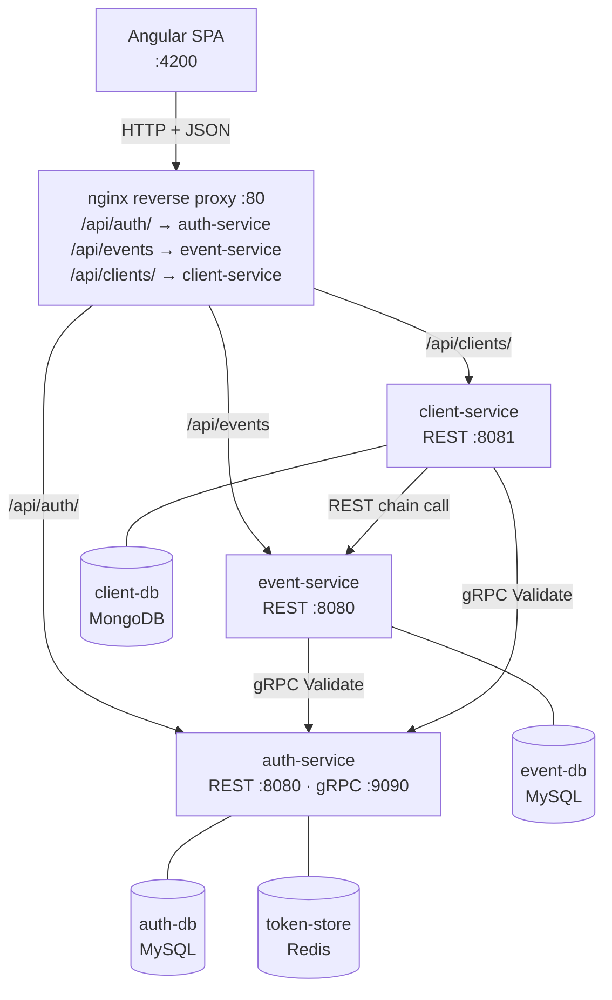
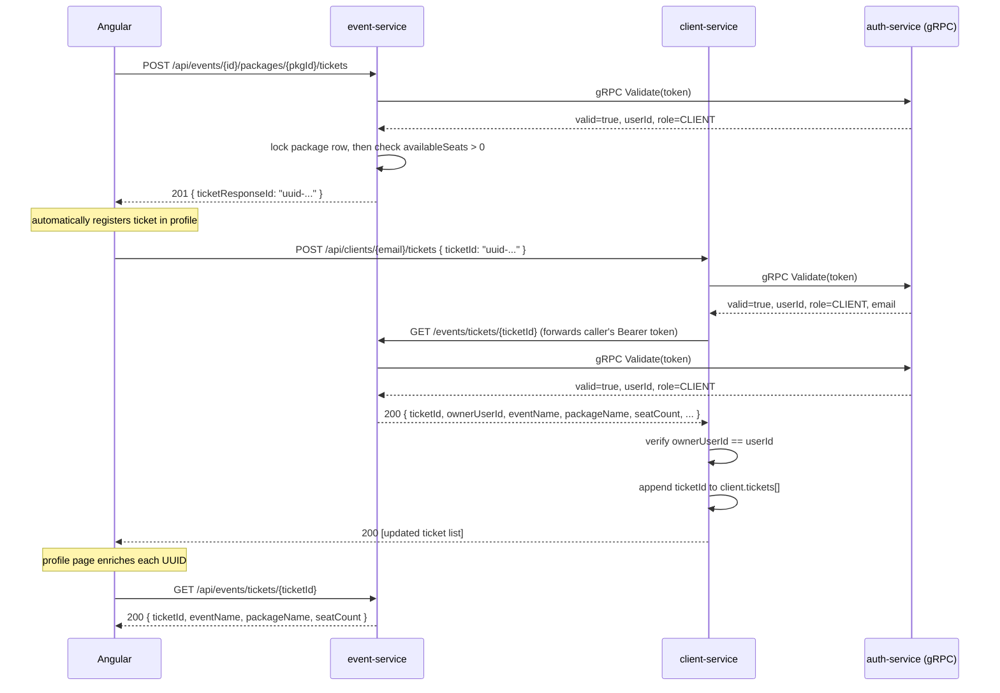
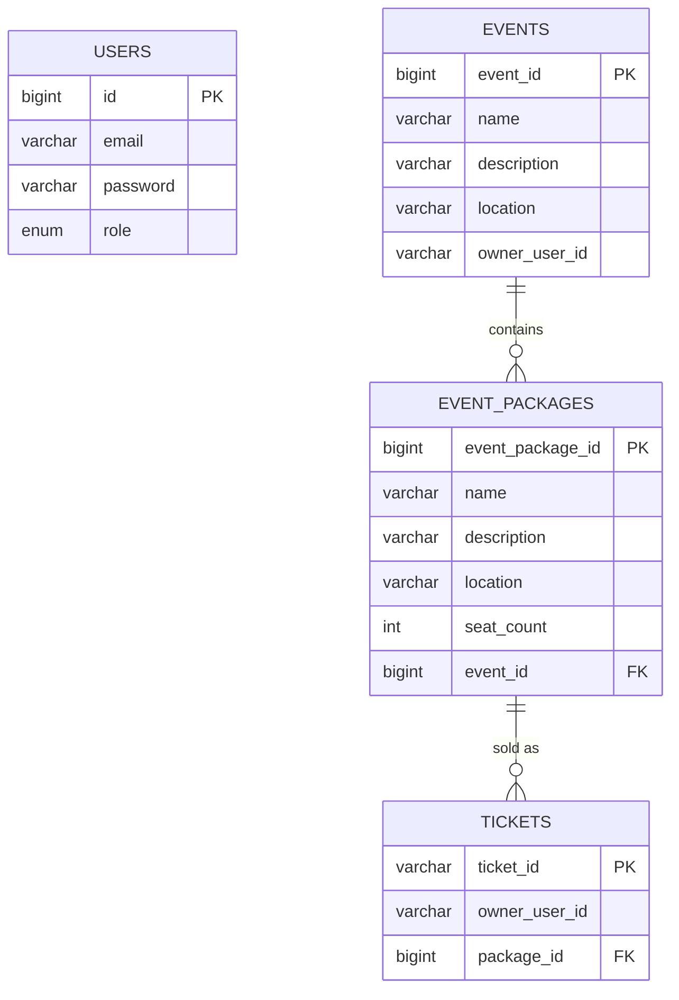

# Event Platform

[](https://github.com/VladLunca/event-platform/actions/workflows/tests.yml)

A microservices-based platform for managing artistic events, ticket packages, and client bookings.

---

## Table of Contents

- [Core Functionality](#core-functionality)
- [Architecture](#architecture)
- [Ticket Purchase Flow](#ticket-purchase-flow)
- [Entity-Relationship Model](#entity-relationship-model)
- [Security Model](#security-model)
- [JWT Token Structure](#jwt-token-structure)
- [gRPC Contract](#grpc-contract)
- [REST API — Auth Service](#rest-api--auth-service)
- [REST API — Event Service](#rest-api--event-service)
- [REST API — Client Service](#rest-api--client-service)
- [Key Design Decisions](#key-design-decisions)
- [Testing](#testing)
- [Database Schemas](#database-schemas)
- [Project Structure](#project-structure)
- [Environment Variables](#environment-variables)
- [Running with Docker](#running-with-docker)
- [Local Development](#local-development)
- [Default Admin Account](#default-admin-account)

---

## Core Functionality

**Event Management**: Users with the `OWNER_EVENT` role create and manage artistic events. Each event has a name, optional location, and description. Packages are added from the event detail page, where several can be filled in and saved in one action — the API itself takes one package per `POST`, and the client issues them in parallel. Each package has a fixed seat count. Only the event owner can modify or delete their own events and packages. Admins have unrestricted access. Event browsing is public — no account is required to list or view events.

**Ticket Sales**: Clients browse public event and package listings and purchase tickets for any package with available seats. The system tracks sold tickets in real time and blocks purchases when a package reaches capacity. Each ticket is identified by a UUID generated at purchase time. Immediately after purchase, the Angular client automatically registers the UUID in the client profile — no manual step required. The profile page also keeps a form for pasting a ticket UUID by hand, which goes through the same validation and is there for a purchase whose automatic registration failed.

**Client Profiles**: Clients maintain a personal profile stored in MongoDB with optional public information and social media links. The profile page displays each registered ticket enriched with the event name, package name, and seat count — resolved live from the event-service. The client-service validates ticket ownership via a chain call to the event-service before persisting any UUID.

**Account Administration**: Anyone can self-register a `CLIENT` account from the profile page (`/profile`) — no dedicated registration page exists. The `ADMIN` role manages access levels from `/manage-user`: instead of creating accounts from scratch, an admin submits an existing user's email together with the new role — `CLIENT` or `OWNER_EVENT` — and the server returns `400` if no account holds that address. There is no user search or listing. Admins also have unrestricted CRUD access to all events, packages, and user roles, but do not interact with client profile data.

---

## Architecture



### Services

| Service | Role | Stack | Port |
|---------|------|-------|------|
| auth-service | Identity management — JWT issuance, validation, blacklist | Spring Boot, MySQL, Redis, gRPC | REST :8080, gRPC :9090 |
| event-service | Events, packages, tickets | Spring Boot, MySQL, Spring HATEOAS | REST :8080 |
| client-service | Client profiles and ticket history | Spring Boot, MongoDB | REST :8081 |
| frontend | Single Page Application | Angular 22, nginx | :80 (→ host :4200) |

### nginx Proxy Rules

nginx is not a separate compose service: the config lives in `frontend/nginx.conf` and is copied into the frontend image by `frontend/Dockerfile`, so the same container serves the built SPA on `:80` and proxies `/api/*` into the Docker network.

| Location prefix | Proxied to | Notes |
|-----------------|-----------|-------|
| `/api/auth/` | `http://auth-service:8080/auth/` | Trailing slash preserved |
| `/api/events` | `http://event-service:8080/events` | Prefix match, no trailing slash |
| `/api/clients/` | `http://client-service:8081/clients/` | Trailing slash preserved |

The `GET /events/tickets/{ticketId}` endpoint is reachable both within the Docker network (used by client-service for chain validation) and externally via `/api/events/tickets/{ticketId}` (used by the Angular frontend to enrich ticket display in the profile page), because the `location /api/events` prefix rule in nginx matches all paths under that prefix. Since it is externally reachable, it requires a valid token like every other ticket endpoint — see [Ticket detail lookup](#ticket-detail-response--get-eventsticketsticketid).

---

## Ticket Purchase Flow



The chain call from client-service to event-service ensures the ticket UUID exists and belongs to the authenticated user before it is stored in MongoDB. The caller's `Authorization` header is forwarded on that call, so the event-service applies its own role check as well — a client can only resolve a ticket that is theirs. The same `GET /events/tickets/{ticketId}` endpoint is called by the Angular frontend to display human-readable ticket info (event name, package name, seat count) in the profile page; the Angular HTTP interceptor attaches the token automatically.

---

## Entity-Relationship Model



`owner_user_id` in `EVENTS` and `TICKETS` stores the JWT `sub` claim as a plain string — there is no foreign key to `USERS`. The services run on separate databases and do not share a schema.

---

## Security Model

### Roles and Permissions

| Role | Capabilities |
|------|-------------|
| `ADMIN` | Change any user's role (`CLIENT` ↔ `OWNER_EVENT`); full CRUD on all events and packages regardless of owner |
| `OWNER_EVENT` | Full CRUD on own events and packages; read-only on events owned by others |
| `CLIENT` | Purchase tickets; view events and packages; manage own profile |

### Authorization Flow

```
HTTP Request + Authorization: Bearer <token>
         │
         ▼
Extract token from Authorization header
         │
         ▼
gRPC Validate(token) → auth-service
         │
         ├── valid=false → 401 Unauthorized
         │
         └── valid=true → { userId, role, email }
                  │
                  ├── role insufficient → 403 Forbidden
                  │
                  └── authorized → process request
```

Read endpoints for events and packages (`GET /events`, `GET /events/{id}`, `GET /events/{id}/packages`, `GET /events/{id}/packages/{packageId}`) are **public** — no token required. Self-registration (from the `/profile` page) is also publicly accessible and always creates a `CLIENT` account; promoting a user to `OWNER_EVENT` requires an `ADMIN` to change their role from `/manage-user`.

That list is exhaustive: **every ticket endpoint requires a token**, including `GET /events/tickets/{ticketId}`, which is reachable from outside the Docker network through the nginx `/api/events` prefix. Ticket responses carry `ownerUserId`, so treating any of them as public would leak which account holds a given ticket to anyone who knows its UUID.

---

## JWT Token Structure

Tokens follow the **JWS** standard (RFC 7515/7519): `base64url(header).base64url(payload).signature`

### Header
```json
{ "alg": "HS256", "typ": "JWT" }
```

### Payload (Claims)

| Claim | Type | Description |
|-------|------|-------------|
| `jti` | string | Random UUID, unique per issued token |
| `sub` | string | User ID — numeric ID stored as string |
| `role` | string | `ADMIN`, `OWNER_EVENT`, or `CLIENT` |
| `email` | string | The account's email address |
| `iat` | number | Issued-at timestamp |
| `exp` | number | Expiration timestamp (default: 24 h) |

The `email` claim exists so client-service can verify that a profile is being created for the caller's own address (see [`POST /clients`](#client-profile)). Carrying it in the token keeps `Validate` free of a database read: the claim is covered by the signature, so tampering with it invalidates the token exactly like tampering with `sub` or `role`.

`jti` carries no meaning on its own — nothing reads it — but without it the token is a pure function of `sub`, `role` and the current second, so two logins of the same user inside one second produce byte-identical tokens. That collides with the blacklist below, which is keyed by token: logging out and immediately logging back in would hand the user a token that is already revoked, and the session would appear broken until the clock ticked over. The UUID makes every issued token a distinct key.

### Signature

```
HMAC-SHA256(base64url(header) + "." + base64url(payload), secretKey)
```

The secret key is configured via `JWT_SECRET` as a 64-character hex string (256-bit).

### Token Blacklist

A JWT is self-contained: any service holding the secret can verify it offline, which is what makes stateless validation cheap. The flip side is that nothing can *un-issue* a token — it stays valid until its `exp` passes. Logout therefore needs a small piece of shared state recording which not-yet-expired tokens have been revoked.

On logout, auth-service writes that record to Redis (`token-store`):

```java
long ttl = jwtService.getExpiration(token) - System.currentTimeMillis();
redis.opsForValue().set("bl:" + sha256(token), "1", Duration.ofMillis(ttl));
```

Every `Validate` gRPC call checks the key before verifying the signature. Three properties follow from the design, and each one is the reason for a specific choice:

**TTL equal to the token's remaining lifetime.** A revoked token only needs to be remembered until the moment it would have expired on its own — after that, signature verification rejects it anyway and the blacklist entry is dead weight. Letting Redis expire the key makes the store self-limiting: it holds at most the tokens revoked within one `jwt.expiration-ms` window, never grows monotonically, and needs no cleanup job, no `@Scheduled` sweep, and no eviction policy.

**External to the JVM, not a field on a bean.** This is the property that actually matters here. An in-process `Set` would fail open in two ways that only appear in the deployment this project is built around: a logged-out but not-yet-expired token becomes valid again the moment auth-service restarts, and a logout served by one replica is invisible to every other replica. Both are silent — nothing errors, the token is simply accepted again. Redis is shared by all instances and survives restarts, so revocation is a property of the system rather than of one process's heap.

**Key is a SHA-256 hash, not the token.** Bearer tokens are credentials; hashing keeps them out of the store in plaintext, and gives fixed-length keys instead of ~250 variable bytes. The lookup is still an exact match, so nothing is lost.

Expiry itself is *not* handled here — `JwtService.isValid()` checks it independently when parsing the signature. The blacklist covers only the window between an explicit logout and natural expiry; the two mechanisms are deliberately separate.

The trade-off is that auth-service now depends on Redis being reachable: if `token-store` is down, `validate` fails rather than silently degrading. That is intentional — the two possible fallbacks are "treat as not blacklisted", which reintroduces exactly the fail-open behaviour above, and "treat as blacklisted", which logs out every user.

The second cost is that validation is no longer a purely local operation: every validated request now pays one Redis round-trip, which is the property JWTs are normally chosen to avoid. That is the price of a 24-hour token lifetime — with short-lived access tokens (5–15 min) plus refresh tokens, revocation would be handled when a token is refreshed and the per-request lookup could be dropped entirely. That is the natural next step; it is not implemented here.

---

## gRPC Contract

Defined in `auth.proto` — identical copy in all services under `src/main/proto/`.

```protobuf
syntax = "proto3";

package auth;

option java_multiple_files = true;
option java_package = "com.example.auth.grpc";
option java_outer_classname = "AuthProto";

service AuthService {
  rpc Login    (LoginRequest)    returns (LoginResponse);
  rpc Validate (ValidateRequest) returns (ValidateResponse);
  rpc Logout   (LogoutRequest)   returns (LogoutResponse);
}

message LoginRequest  { string username = 1; string password = 2; }
message LoginResponse { string token    = 1; }

message ValidateRequest  { string token = 1; }
message ValidateResponse {
  bool   valid   = 1;
  string user_id = 2;
  string role    = 3;
  string email   = 4;
}

message LogoutRequest  { string token   = 1; }
message LogoutResponse { bool   success = 1; }
```

`Login` is implemented by `AuthGrpcService` but no service calls it — the Angular client logs in over REST. It exists as the gRPC counterpart of `POST /auth/login` and maps bad credentials to `UNAUTHENTICATED`.

On a rejected token, `valid` is `false` and `user_id`, `role` and `email` are all empty strings — proto3 has no null, so an absent value is the empty string, and callers must treat an empty `email` as "unknown" rather than as a match.

All RPCs use the **Unary RPC** pattern. event-service and client-service connect to auth-service via `ManagedChannelBuilder.forAddress(AUTH_GRPC_HOST, AUTH_GRPC_PORT).usePlaintext()`.

---

## REST API — Auth Service

Base path: `/auth` · External: `/api/auth/` · Port: `8080` (internal), `8090` (host debug)

| Method | Path | Auth | Status | Description |
|--------|------|------|--------|-------------|
| `POST` | `/auth/login` | Public | 200, 401 | Authenticate, receive JWT |
| `POST` | `/auth/logout` | Bearer | 200 | Invalidate token (add to blacklist) |
| `POST` | `/auth/register` | Public | 201, 409 | Self-register a `CLIENT` account, receive JWT |
| `PATCH` | `/auth/users/role` | ADMIN | 200, 400, 403 | Change an existing user's role |

### POST `/auth/login`

```json
// Request
{ "email": "owner@platform.com", "password": "secret123" }

// 200
{ "token": "eyJhbGciOiJIUzI1NiJ9..." }

// 401
{ "error": "Credentiale invalide" }
```

### POST `/auth/logout`

```
Authorization: Bearer <token>
```

```json
// 200
{ "success": true }
```

### POST `/auth/register`

```json
// Request
{ "email": "client@platform.com", "password": "pass123" }

// 201
{ "token": "eyJhbGciOiJIUzI1NiJ9..." }

// 409
{ "error": "Email deja existent" }
```

The new account is always created with role `CLIENT`. There is no public endpoint to self-register as `OWNER_EVENT` or `ADMIN` — an admin must promote the account afterwards via `PATCH /auth/users/role`.

### PATCH `/auth/users/role`

```json
// Request (ADMIN token required)
{ "email": "client@platform.com", "role": "OWNER_EVENT" }

// 200
{ "message": "Rol actualizat cu succes" }

// 400
{ "error": "Utilizator inexistent" }

// 403
{ "error": "Acces interzis" }
```

Assignable roles from the admin UI: `OWNER_EVENT`, `CLIENT`. The endpoint itself accepts any value of the `Role` enum (`ADMIN`, `OWNER_EVENT`, `CLIENT`), but the frontend only exposes the two non-admin roles to avoid accidental admin escalation through the UI.

---

## REST API — Event Service

Base path: `/events` · External: `/api/events` · Port: `8080`

All responses include HATEOAS `_links`. `GET` endpoints are public. Write endpoints require `Authorization: Bearer <token>`.

List endpoints (`GET /events`, `GET /events/{eventId}/packages`, `GET /events/{eventId}/packages/{packageId}/tickets`) return a HAL collection instead of a bare array, so the individual items keep their own `_links`:

```json
{
  "_embedded": {
    "events": [
      { "eventResponseId": 1, "name": "Concert Iași", "_links": { "self": { "href": "/events/1" } } }
    ]
  }
}
```

The Angular `HateoasService.unwrapCollection()` transparently extracts the array from `_embedded` (or passes a bare array through), so consumers of `EventService` still work with plain `T[]`.

### Events

| Method | Path | Auth | Status | Description |
|--------|------|------|--------|-------------|
| `GET` | `/events` | Public | 200 | List events (paginated, filterable) |
| `GET` | `/events/{id}` | Public | 200, 404 | Get event by ID |
| `POST` | `/events` | OWNER_EVENT or ADMIN | 201, 401, 403 | Create event |
| `PUT` | `/events/{id}` | OWNER_EVENT (own) or ADMIN | 200, 401, 403, 404 | Replace event |
| `DELETE` | `/events/{id}` | OWNER_EVENT (own) or ADMIN | 204, 401, 403, 404 | Delete event and all its packages and tickets |

#### Query parameters — `GET /events`

| Parameter | Type | Default | Description |
|-----------|------|---------|-------------|
| `name` | string | — | Partial, case-insensitive name filter |
| `page` | int | `0` | Page index (0-based) |
| `size` | int | `10` | Items per page |

Results are sorted alphabetically by name.

#### Event body (`POST`, `PUT`)

```json
{ "name": "Concert Iași", "location": "Sala Palatului", "description": "Un concert extraordinar" }
```

`name` is required. `location` and `description` are optional.

#### Event response

```json
{
  "eventResponseId": 1,
  "name": "Concert Iași",
  "location": "Sala Palatului",
  "description": "Un concert extraordinar",
  "_links": {
    "self":     { "href": "/events/1" },
    "packages": { "href": "/events/1/packages" }
  }
}
```

`ownerUserId` is stored server-side and never exposed in responses.

The two links above are always present. When the request carries a token belonging to an `ADMIN` or to the event's own `OWNER_EVENT`, three more are added:

| Rel | Method the frontend uses it with | Target |
|-----|--------------------------------|--------|
| `edit` | `PUT` | `/events/{id}` |
| `delete` | `DELETE` | `/events/{id}` |
| `create-package` | `POST` | `/events/{id}/packages` |

The Angular client treats these as the authorization signal rather than re-deriving it: `canManageEvent()` is `hateoas.has(event, 'edit')`.

---

### Packages

| Method | Path | Auth | Status | Description |
|--------|------|------|--------|-------------|
| `GET` | `/events/{eventId}/packages` | Public | 200, 404 | List packages for an event |
| `GET` | `/events/{eventId}/packages/{packageId}` | Public | 200, 404 | Get package by ID |
| `POST` | `/events/{eventId}/packages` | OWNER_EVENT (own event) or ADMIN | 201, 401, 403, 404 | Create package |
| `PUT` | `/events/{eventId}/packages/{packageId}` | OWNER_EVENT (own event) or ADMIN | 200, 401, 403, 404 | Replace package |
| `DELETE` | `/events/{eventId}/packages/{packageId}` | OWNER_EVENT (own event) or ADMIN | 204, 401, 403, 404 | Delete package and all its tickets |

#### Package body (`POST`, `PUT`)

```json
{ "name": "VIP", "location": "Zona A", "description": "Acces VIP", "seatCount": 50 }
```

`name` and `seatCount` are required (`seatCount` ≥ 1). `location` and `description` are optional.

#### Package response

```json
{
  "packageResponseId": 3,
  "name": "VIP",
  "location": "Zona A",
  "description": "Acces VIP",
  "seatCount": 50,
  "availableSeats": 47,
  "_links": {
    "self":  { "href": "/events/1/packages/3" },
    "event": { "href": "/events/1" }
  }
}
```

`availableSeats` is computed dynamically as `seatCount − COUNT(tickets)`.

`self` and `event` are always present; the rest depend on who is asking:

| Rel | Added for | Target |
|-----|-----------|--------|
| `edit-package` | ADMIN or the event's OWNER_EVENT | `PUT /events/{eventId}/packages/{packageId}` |
| `delete-package` | ADMIN or the event's OWNER_EVENT | `DELETE /events/{eventId}/packages/{packageId}` |
| `tickets` | ADMIN or the event's OWNER_EVENT | `GET .../tickets` — the sold-ticket list |
| `purchase` | CLIENT | `POST .../tickets` — buy a ticket |

An anonymous reader gets only `self` and `event`. An invalid or expired token is treated as anonymous rather than rejected, so a stale session degrades to the public view instead of breaking the page.

---

### Tickets

| Method | Path | Auth | Status | Description |
|--------|------|------|--------|-------------|
| `GET` | `/events/{eventId}/packages/{packageId}/tickets` | OWNER_EVENT (own) or ADMIN | 200, 401, 403, 404 | List all tickets for a package |
| `POST` | `/events/{eventId}/packages/{packageId}/tickets` | CLIENT | 201, 401, 403, 404, 409 | Purchase a ticket |
| `GET` | `/events/{eventId}/packages/{packageId}/tickets/{ticketId}` | CLIENT (own), OWNER_EVENT (own), or ADMIN | 200, 401, 403, 404 | Get ticket by ID (HATEOAS) |
| `GET` | `/events/tickets/{ticketId}` | CLIENT (own), OWNER_EVENT (own event), or ADMIN | 200, 401, 403, 404 | Ticket detail lookup — used by client-service chain call and Angular profile page |

#### Ticket response — `GET /events/{eventId}/packages/{packageId}/tickets/{ticketId}`

```json
{
  "ticketResponseId": "f47ac10b-58cc-4372-a567-0e02b2c3d479",
  "ownerUserId": "42",
  "_links": {
    "self":    { "href": "/events/1/packages/3/tickets/f47ac10b-58cc-4372-a567-0e02b2c3d479" },
    "package": { "href": "/events/1/packages/3" }
  }
}
```

`409 Conflict` is returned when all seats are sold. The purchase takes a write lock on the package row before counting sold seats, so two concurrent buyers competing for the last seat are serialized: one gets `201`, the other `409`. A CLIENT can view only their own ticket; an OWNER_EVENT can view any ticket for packages on their own event.

#### Ticket detail response — `GET /events/tickets/{ticketId}`

```json
{
  "ticketId": "f47ac10b-58cc-4372-a567-0e02b2c3d479",
  "ownerUserId": "42",
  "eventId": 1,
  "eventName": "Concert Iași",
  "packageId": 3,
  "packageName": "VIP",
  "seatCount": 50
}
```

This endpoint resolves the ticket → package → event chain in a single call. It is used by client-service (reads `ownerUserId` for ownership verification) and by the Angular profile page (reads `eventName`, `packageName`, `seatCount` for display).

A valid token is required and the same role rule as the HATEOAS ticket endpoint applies: an ADMIN resolves any ticket, a CLIENT only their own, an OWNER_EVENT only tickets belonging to packages on their own event. Anything else returns `403`. Both callers already carry a token — client-service forwards the caller's `Authorization` header on the chain call, and the Angular HTTP interceptor attaches it on the frontend.

---

### Error responses

```json
{ "error": "<mesaj>" }
```

| Status | Condition |
|--------|-----------|
| `400` | No `Authorization` header at all on an endpoint that requires one, or a body that fails `@Valid` — both are rejected by Spring before any controller code runs |
| `401` | A header is present but unusable: not `Bearer …`, or a token that is invalid, expired or blacklisted |
| `403` | Valid token but insufficient role, or not the owner of the resource |
| `404` | Resource not found |
| `409` | Conflict — no seats available |
| `503` | The gRPC call to auth-service failed or exceeded its 5s deadline — the request could not be authorized because a dependency is down, not because the token is bad |

The `{ "error": … }` shape above comes from `GlobalExceptionHandler`, which covers 401/403/404/409/503. The two `400` cases are raised by Spring itself and are **not** handled there, so they carry Spring's default error body instead. `TicketLookupControllerTest` pins the missing-header case at `400`, the point being that the request never reaches the service.

---

## REST API — Client Service

Base path: `/clients` · External: `/api/clients/` · Port: `8081`

All endpoints require `Authorization: Bearer <token>`.

### Client Profile

| Method | Path | Auth | Status | Description |
|--------|------|------|--------|-------------|
| `POST` | `/clients` or `/clients/` | CLIENT | 201, 401, 403, 409 | Create profile — email in the body must match the `email` claim of the caller's token |
| `GET` | `/clients/{email}` | CLIENT (own) or OWNER_EVENT | 200, 401, 403, 404 | Get profile — CLIENT sees all fields; OWNER_EVENT sees only public fields |
| `PATCH` | `/clients/{email}` | CLIENT (own) | 200, 401, 403, 404 | Partial update — only provided fields are changed |
| `DELETE` | `/clients/{email}` | CLIENT (own) | 204, 401, 403, 404 | Delete profile |

#### POST `/clients` — ownership of the email

The email in the body is the profile's lookup key for every later read, so it has to be the caller's own address: otherwise any `CLIENT` could open a profile under someone else's email and own that address inside this service. client-service compares the body against the `email` claim carried by the token (case-insensitively) and returns `403` on a mismatch:

```json
{ "error": "Puteti crea un profil doar pentru propriul email" }
```

If the token carries no email at all — a token signed before the claim existed is still a valid signature — the request is refused rather than trusted, so the check fails closed.

#### GET `/clients/{email}` — response (CLIENT)

```json
{
  "email": "client@example.com",
  "firstName": "Ion",
  "lastName": "Popescu",
  "publicInfo": true,
  "socialMedia": {
    "linkedin": "https://linkedin.com/in/ion",
    "publicSocialMedia": false
  },
  "tickets": ["f47ac10b-58cc-4372-a567-0e02b2c3d479"]
}
```

`OWNER_EVENT` receives only the fields where `publicInfo = true`, and `socialMedia` only when `publicSocialMedia = true`.

### Tickets

| Method | Path | Auth | Status | Description |
|--------|------|------|--------|-------------|
| `GET` | `/clients/{email}/tickets` | CLIENT (own) | 200, 401, 403, 404 | List registered ticket UUIDs |
| `POST` | `/clients/{email}/tickets` | CLIENT (own) | 200, 401, 403, 404 | Register a ticket UUID — triggers chain call to event-service |

#### POST `/clients/{email}/tickets`

```json
// Request
{ "ticketId": "f47ac10b-58cc-4372-a567-0e02b2c3d479" }

// 200 — returns updated ticket list
["f47ac10b-58cc-4372-a567-0e02b2c3d479", "..."]

// 403 — the ticket does not belong to the caller
{ "error": "Biletul nu va apartine" }

// 404 — the ticket does not exist in the event-service
{ "error": "Biletul nu a fost gasit in sistemul de evenimente" }
```

The chain call to `GET /events/tickets/{ticketId}` is made synchronously before persisting the UUID, forwarding the caller's `Authorization` header. The outcome maps as follows:

| Event-service response | Client-service returns |
|------------------------|------------------------|
| `200`, `ownerUserId` matches the caller | `200` — UUID persisted |
| `200`, `ownerUserId` belongs to someone else | `403` |
| `401` / `403` (event-service refused the lookup) | `403` |
| `404` | `404` |
| unreachable, timed out, or `5xx` | `409` — "Serviciul de evenimente nu este disponibil" |

The UUID is appended with an atomic `$addToSet`, so registering the same ticket twice is a no-op and two registrations racing on the same profile cannot overwrite each other — see [Key Design Decisions](#key-design-decisions).

The chain call is bounded by a 2s connect timeout and a 5s read timeout. Without them an event-service that is unreachable *without refusing the connection* — a paused container, a host that silently drops packets — would block the client-service request thread indefinitely, and the "unavailable" branch would never be reached because no exception would ever be raised.

---

## Key Design Decisions

**No cross-database foreign keys**: `owner_user_id` in `events` and `tickets` stores the JWT `sub` as a plain string. The auth-service, event-service, and client-service each have their own isolated database. Referential integrity between services is enforced by application logic (ownership checks), not by database constraints.

**JWT claims over session state**: Every protected request carries all necessary identity information (`userId`, `role`, `email`) inside the JWT. The `email` claim is there for exactly this reason: client-service has to check profile ownership, and reading the address out of the signed token keeps `Validate` from needing a database lookup per request. Services do not maintain sessions — the token is the only source of truth per request, so any replica can serve any request and the services scale independently. The blacklist does not contradict this: it is *shared* state, not *per-client session* state. No instance remembers anything about a caller between requests; it consults a store every instance can see, exactly as it consults MySQL. What the blacklist actually costs is lookup-free validation, not statelessness — see [Token Blacklist](#token-blacklist).

**gRPC for token validation**: event-service and client-service validate tokens via gRPC instead of REST to reduce per-request overhead (HTTP/2 multiplexing, binary Protobuf encoding, persistent connection).

**Chain call for ticket registration**: After purchasing a ticket from event-service, the Angular client automatically calls client-service to register the UUID. client-service performs a synchronous chain call to `GET /events/tickets/{ticketId}` to confirm the ticket exists and that `ownerUserId` matches the authenticated user before persisting the UUID to MongoDB. This prevents stale or fabricated ticket UUIDs in client profiles. The same endpoint is also called by the Angular profile page to enrich each UUID with human-readable event and package info, avoiding a separate lookup service.

**HATEOAS on event-service responses**: All event, package, and ticket responses include `_links`. This allows the frontend to discover related resources (e.g., navigate from an event to its packages list) without hard-coding URL structures.

**Redis-backed token blacklist with TTL**: Logout is the one operation a stateless JWT cannot express on its own, so it needs shared state — kept in Redis rather than in the auth-service heap, with a TTL equal to the token's remaining lifetime so entries expire on their own. An in-process set would fail open under exactly the deployment this project targets: revocations lost on restart, and invisible to other replicas. See [Token Blacklist](#token-blacklist) for the full reasoning.

**`availableSeats` computed at query time**: Available seat count is never stored — it is calculated as `seatCount − COUNT(tickets)` per request. This avoids double-update consistency issues (updating both a counter and inserting a row) at the cost of a count query per package read.

**Pessimistic lock on purchase**: Because availability is derived from a `COUNT` rather than a stored counter, the read and the insert are two separate statements — and a plain transaction does not stop two concurrent buyers from both reading the same count and both inserting. `purchaseTicket` therefore loads the package through `EventPackageRepository.findByIdForUpdate` (`@Lock(PESSIMISTIC_WRITE)`, i.e. `SELECT ... FOR UPDATE`) *before* counting, which serializes buyers competing for the same package until the transaction commits. The alternative — a stored `sold_seats` counter updated with a conditional `UPDATE ... WHERE sold_seats < seat_count` — would avoid the lock but reintroduce the double-update problem the design decision above deliberately avoids.

**Atomic `$addToSet` instead of a lock on the client profile**: Registering a ticket appends a UUID to an array inside the client document. MongoDB offers no equivalent of the `SELECT ... FOR UPDATE` used on the package row — there is nothing to hold between a read and a write — but it does guarantee that a single-document update is atomic. Loading the profile, appending in memory and saving it back would therefore drop tickets: each save rewrites the whole document as that caller read it, so two registrations racing on the same profile leave only one. `ClientRepositoryImpl.addTicket` expresses the change as one server-side `$addToSet`, which is safe under concurrency and idempotent in the same stroke — the array gains the UUID only if it is not already there, so the duplicate check disappears as well.

**Cascade delete via JPA**: Deleting an event cascades to its packages; deleting a package cascades to its tickets. The cascade is configured at the JPA level (`CascadeType.ALL`, `orphanRemoval = true`), not at the database constraint level.

---

## Testing

The suites do not chase line coverage. They cover the places where a bug is **silent** — where the system keeps returning 200 while doing the wrong thing: authorization decisions, token revocation, seat accounting under concurrency, and the failure modes of one service calling another. CRUD paths that fail loudly when broken are deliberately left to manual testing.

### What each suite locks down

**auth-service** — 31 tests

| Suite | Kind | What it protects |
|-------|------|------------------|
| `JwtServiceTest` | unit | A token is only accepted if the signature holds: foreign secret, `role` escalated from `CLIENT` to `ADMIN`, `sub` swapped to another user, **`email` swapped to another address**, `alg: none` with an empty signature, and expired-but-correctly-signed tokens are all rejected. Also pins `getExpiration() == 0` for unreadable tokens — the contract the blacklist TTL is derived from — that two tokens issued in the same second differ, and that a token minted without an email still validates but reports none. |
| `AuthGrpcServiceTest` | in-process gRPC + Mockito | The wire contract: a valid token answers with `user_id`/`role`/`email`, a rejected one answers `valid=false` **with all three fields empty**, a valid token that carries no email answers with an empty email instead of failing the call, rejection is a normal response rather than a gRPC error, and bad credentials map to `UNAUTHENTICATED` instead of a generic failure. |
| `TokenBlacklistIntegrationTest` | Testcontainers (MySQL + Redis), full context over in-process gRPC | The logout story end to end: a revoked token stops validating immediately; the Redis key is `bl:` + SHA-256, never the token in clear text; its TTL matches the token's remaining lifetime; an already-expired token is not stored at all; logging in again right after logout yields a working token; and the revocation is visible through a second Redis connection standing in for another replica. |

**event-service** — 28 tests

| Suite | Kind | What it protects |
|-------|------|------------------|
| `TicketServiceTest` | unit | The ticket visibility matrix — admin sees any ticket, a client only its own, an event owner only tickets of its own events, unknown roles nothing — plus sold-out rejection and the fact that `purchaseTicket` loads the package *through the locking query*. |
| `TicketLookupControllerTest` | `@WebMvcTest` | The HTTP boundary: a missing `Authorization` header never reaches the service, an invalid token is 401, a foreign ticket is 403, the identity used for the check comes from the token and not from the request, and an auth-service outage is 503 rather than 500. |
| `PackageControllerTest` | `@WebMvcTest` | That package reads really are public — both the list and the single package answer 200 with **no** `Authorization` header — and that the HAL links are the authorization signal they are documented to be: anonymous gets `self`+`event` only, an owner additionally gets `edit-package`/`delete-package`/`tickets`, a CLIENT gets `purchase` and nothing else, and an expired token degrades to the anonymous view instead of erroring. |
| `TicketPurchaseConcurrencyTest` | Testcontainers (MySQL) | Seats are never oversold: two buyers racing for the last seat, ten buyers racing for three. The third test is a **control** — it runs the unsafe count-then-insert the code used before the pessimistic lock, against the same database and thread schedule, and requires it to oversell. If the control ever stopped overselling, the harness could not expose the race and the other two tests would be proving nothing. |

**client-service** — 25 tests

| Suite | Kind | What it protects |
|-------|------|------------------|
| `ClientTicketConcurrencyTest` | Testcontainers (MongoDB) | Ten tickets registered concurrently on one profile all survive, the same ticket added concurrently or twice leaves a single copy, and the returned list matches what was stored. The last test is a **control**: it runs the read-modify-write the code used before the atomic `$addToSet` and requires it to lose tickets under the same load. |
| `EventVerificationServiceTest` | real HTTP stub server | The chain call to event-service: the caller's `Authorization` header is forwarded, a ticket owned by someone else is 403 and not "service unavailable", a missing ticket is 404, a broken event-service is reported as unavailable, and an unresponsive one does not block the request forever. |
| `AuthGrpcClientTest` | real gRPC server on an ephemeral port | Every `Validate` call carries a **freshly computed** deadline instead of one baked into the stub at construction, a silent auth-service fails with `DEADLINE_EXCEEDED` in ~5 s rather than hanging, and a failing one surfaces as `UNAVAILABLE` — the status the handler turns into 503. |
| `ClientServiceTest` | unit + Mockito | Profile creation is bound to the caller's identity: a profile for the caller's own email is created, one for somebody else's email is refused and never reaches the repository, the comparison ignores case, a token with no email is refused rather than trusted, the stored `userId` comes from the token and not from the body, and a duplicate email is still a conflict. |

Each module count also includes one `contextLoads` smoke test (`*ApplicationTests`) that boots the full Spring context, which is why the suites listed per module sum to one less than the module total.

### Calibration

A concurrency test would be meaningless if the scenario it describes could not actually fail on the harness running it, so each one was checked against the broken implementation it guards:

- the two control tests ship in the repo and are green — the unsynchronized count-then-insert oversells seats, and the read-modify-write loses tickets;
- the per-call deadline test was run against a stub built once with `withDeadlineAfter(5, SECONDS)`: the second call arrived with 3.4 s of deadline left, below the 4 s the test demands, while the real client leaves ~4.9 s on every call;
- the `jti` test was run against a `generate` without it: two logins in the same second produced byte-identical tokens.

### Running

```bash
# per service
cd auth-service && ./mvnw test

# only the tests that need no containers
cd auth-service   && ./mvnw test -Dtest='JwtServiceTest,AuthGrpcServiceTest'
cd event-service  && ./mvnw test -Dtest='TicketServiceTest,TicketLookupControllerTest,PackageControllerTest'
cd client-service && ./mvnw test -Dtest='ClientServiceTest,EventVerificationServiceTest,AuthGrpcClientTest'

# frontend (vitest on jsdom) — shell smoke test: navbar, router outlet, logged-out state
cd frontend && npm test -- --watch=false
```

Every push and pull request runs all of it in GitHub Actions (`.github/workflows/tests.yml`): the three Maven modules in parallel plus the frontend job. Testcontainers works unchanged on the hosted runners, which have Docker; a failed module uploads its surefire reports as an artifact.

`TokenBlacklistIntegrationTest`, `TicketPurchaseConcurrencyTest` and `ClientTicketConcurrencyTest` start MySQL, Redis and MongoDB containers through Testcontainers, so Docker must be running; everything else is self-contained (in-process gRPC, `@WebMvcTest`, or a stub HTTP server on an ephemeral port). No test touches `docker-compose.yml` or any long-running local database.

### Not covered

`EventController`, `TicketController` and `ClientController`, the event/package CRUD services, the client profile privacy rules (`publicInfo`, `publicSocialMedia` in `ClientResponse.fromPublic`), profile update and delete, and — beyond the shell smoke test — the Angular guards, interceptor and services.

---

## Database Schemas

The two MySQL schemas are created by Hibernate at startup from the JPA entities (`spring.jpa.hibernate.ddl-auto=update`) — there are no migration scripts and no Flyway/Liquibase. The tables below describe what Hibernate generates, so changing an entity changes the schema on the next boot, and a column removed from an entity is left behind rather than dropped. MongoDB needs no schema; the `clients` collection is created on first write and the unique index comes from `@Indexed(unique = true)`.

### Auth Service — MySQL

**`users`**

| Column | Type | Constraints |
|--------|------|-------------|
| `id` | BIGINT | PK, AUTO_INCREMENT |
| `email` | VARCHAR | UNIQUE, NOT NULL |
| `password` | VARCHAR | NOT NULL — BCrypt hashed |
| `role` | VARCHAR | NOT NULL — `@Enumerated(EnumType.STRING)`, so Hibernate stores the enum name and adds a `CHECK role IN ('ADMIN','OWNER_EVENT','CLIENT')`; it is not a native MySQL `ENUM` column |

---

### Event Service — MySQL

**`events`**

| Column | Type | Constraints |
|--------|------|-------------|
| `event_id` | BIGINT | PK, AUTO_INCREMENT |
| `name` | VARCHAR | NOT NULL |
| `description` | VARCHAR | NULLABLE |
| `location` | VARCHAR | NULLABLE |
| `owner_user_id` | VARCHAR | NOT NULL — no FK to users |

**`event_packages`**

| Column | Type | Constraints |
|--------|------|-------------|
| `event_package_id` | BIGINT | PK, AUTO_INCREMENT |
| `name` | VARCHAR | NOT NULL |
| `description` | VARCHAR | NULLABLE |
| `location` | VARCHAR | NULLABLE |
| `seat_count` | INT | NOT NULL — the `≥ 1` floor is a `@Min(1)` bean-validation rule on `CreatePackageRequest`, not a database constraint |
| `event_id` | BIGINT | FK → events.event_id, NOT NULL |

**`tickets`**

| Column | Type | Constraints |
|--------|------|-------------|
| `ticket_id` | VARCHAR | PK — UUID generated at purchase |
| `owner_user_id` | VARCHAR | NOT NULL — no FK to users |
| `package_id` | BIGINT | FK → event_packages.event_package_id, NOT NULL |

---

### Client Service — MongoDB

**`clients` collection**

```json
{
  "_id": "ObjectId",
  "email": "client@example.com",
  "userId": "42",
  "firstName": "Ion",
  "lastName": "Popescu",
  "publicInfo": true,
  "socialMedia": {
    "linkedin": "https://linkedin.com/in/...",
    "publicSocialMedia": false
  },
  "tickets": [
    "f47ac10b-58cc-4372-a567-0e02b2c3d479"
  ]
}
```

`email` carries a unique index (`@Indexed(unique=true)`). `userId` is the JWT `sub` claim stored at profile creation — it ties the MongoDB document to the auth-service user without a cross-database foreign key. `tickets` stores UUID strings matching `ticket_id` from the event-service. `publicInfo` controls profile visibility to `OWNER_EVENT` users. `firstName`, `lastName`, and `socialMedia` are optional.

---

## Project Structure

```
event-platform/
├── auth-service/
│   ├── src/main/java/com/example/auth_service/
│   │   ├── AuthServiceApplication.java
│   │   ├── controller/       AuthController.java
│   │   ├── dto/              LoginRequest.java · CreateUserRequest.java
│   │   │                     UpdateRoleRequest.java · ValidateResult.java
│   │   ├── exception/        InvalidCredentialsException.java
│   │   ├── grpc/             AuthGrpcService.java
│   │   ├── model/            User.java · Role.java
│   │   ├── repository/       UserRepository.java
│   │   ├── service/          AuthService.java · JwtService.java · TokenBlacklistService.java
│   │   └── config/           DataSeeder.java · SecurityConfig.java
│   ├── src/main/proto/       auth.proto
│   └── src/test/java/com/example/auth_service/
│       ├── AuthServiceApplicationTests.java    (contextLoads smoke test)
│       ├── grpc/             AuthGrpcServiceTest.java
│       └── service/          JwtServiceTest.java · TokenBlacklistIntegrationTest.java
│
├── event-service/
│   ├── src/main/java/com/example/auth_service/      ← note: package is auth_service
│   │   ├── EventServiceApplication.java
│   │   ├── controller/       EventController.java · PackageController.java
│   │   │                     TicketController.java · TicketLookupController.java
│   │   ├── dto/              CreateEventRequest.java · EventResponse.java
│   │   │                     CreatePackageRequest.java · PackageResponse.java
│   │   │                     TicketResponse.java · TicketDetailResponse.java
│   │   ├── exception/        GlobalExceptionHandler.java · NotFoundException.java
│   │   │                     ForbiddenException.java · UnauthorizedException.java
│   │   ├── grpc/             AuthGrpcClient.java
│   │   ├── model/            Event.java · EventPackage.java · Ticket.java
│   │   ├── repository/       EventRepository.java · EventPackageRepository.java · TicketRepository.java
│   │   └── service/          EventService.java · PackageService.java · TicketService.java
│   │                         TokenValidationService.java
│   ├── src/main/proto/       auth.proto
│   └── src/test/java/com/example/auth_service/
│       ├── EventServiceApplicationTests.java   (contextLoads smoke test)
│       ├── controller/       TicketLookupControllerTest.java · PackageControllerTest.java
│       └── service/          TicketServiceTest.java · TicketPurchaseConcurrencyTest.java
│
├── client-service/
│   ├── src/main/java/com/example/client_service/
│   │   ├── ClientServiceApplication.java
│   │   ├── controller/       ClientController.java
│   │   ├── dto/              CreateClientRequest.java · UpdateClientRequest.java
│   │   │                     AddTicketRequest.java · ClientResponse.java
│   │   ├── exception/        GlobalExceptionHandler.java · NotFoundException.java
│   │   │                     ForbiddenException.java · UnauthorizedException.java
│   │   ├── grpc/             AuthGrpcClient.java
│   │   ├── model/            Client.java
│   │   ├── repository/       ClientRepository.java · ClientRepositoryCustom.java
│   │   │                     ClientRepositoryImpl.java (atomic $addToSet)
│   │   └── service/          TokenValidationService.java · ClientService.java
│   │                         ClientTicketService.java · EventVerificationService.java
│   ├── src/main/proto/       auth.proto
│   └── src/test/java/com/example/client_service/
│       ├── ClientServiceApplicationTests.java  (contextLoads smoke test)
│       ├── grpc/             AuthGrpcClientTest.java
│       └── service/          EventVerificationServiceTest.java
│                             ClientTicketConcurrencyTest.java · ClientServiceTest.java
│
├── frontend/
│   ├── src/app/
│       ├── app.ts · app.html · app.scss · app.routes.ts · app.config.ts · app.spec.ts
│       ├── core/
│       │   ├── guards/       auth.guard.ts · role.guard.ts  (only role.guard is wired into routes)
│       │   ├── interceptors/ auth.interceptor.ts
│       │   ├── models/       user.model.ts · event.model.ts · client.model.ts
│       │   └── services/     auth.service.ts · event.service.ts · client.service.ts
│       │                     hateoas.service.ts (follows `_links`, unwraps HAL `_embedded` collections)
│       ├── features/
│       │   ├── auth/         login/
│       │   ├── events/       event-list/ · event-detail/ · create-event/ · edit-event/
│       │   ├── admin/        manage-user/update-role.component   (route: /manage-user — ADMIN only)
│       │   └── profile/      profile.component (ts · html · scss) — also handles self-registration
│       └── shared/           navbar/ · unauthorized/
│   ├── nginx.conf            serves the built SPA and proxies /api/* (baked into the image)
│   └── Dockerfile
│
├── .github/workflows/        tests.yml — the three Maven modules plus the frontend
├── docker-compose.yml
└── .env.example
```

---

## Environment Variables

Copy `.env.example` to `.env`:

```bash
cp .env.example .env
```

The placeholders in the table below are the literal values `.env.example` ships, and everything except `JWT_SECRET` boots as-is. `JWT_SECRET` must be replaced before the first start: `JwtService` parses it as hex, so the placeholder string is rejected and auth-service fails to come up.

```bash
sed -i "s|^JWT_SECRET=.*|JWT_SECRET=$(openssl rand -hex 32)|" .env
```

| Variable | Default | Description |
|----------|---------|-------------|
| `AUTH_DB_NAME` | `auth_db` | Auth service MySQL database |
| `AUTH_DB_USER` | `auth_user` | Auth service DB username |
| `AUTH_DB_PASSWORD` | `change_me` | Auth service DB password |
| `AUTH_DB_ROOT_PASSWORD` | `change_me_root` | MySQL root password |
| `AUTH_DB_PORT` | `3306` | Host port for auth-db |
| `EVENT_DB_NAME` | `event_db` | Event service MySQL database |
| `EVENT_DB_USER` | `event_user` | Event service DB username |
| `EVENT_DB_PASSWORD` | `change_me` | Event service DB password |
| `EVENT_DB_ROOT_PASSWORD` | `change_me_root` | MySQL root password |
| `EVENT_DB_PORT` | `3307` | Host port for event-db |
| `CLIENT_DB_NAME` | `client_db` | Client service MongoDB database |
| `CLIENT_DB_USER` | `client_user` | MongoDB username |
| `CLIENT_DB_PASSWORD` | `change_me` | MongoDB password |
| `CLIENT_DB_PORT` | `27017` | Host port for client-db |
| `REDIS_PORT` | `6379` | Host port for token-store (Redis) |
| `JWT_SECRET` | — | 64-character hex string (256-bit HS256 key) — generate with `openssl rand -hex 32` |
| `JWT_EXPIRATION_MS` | `86400000` | Token validity in ms (default 24 h) |
| `ADMIN_EMAIL` | `admin@platform.com` | Email of the seeded admin account |
| `ADMIN_PASSWORD` | `change_me_admin` | Password of the seeded admin account |

---

## Running with Docker

### Start all services

```bash
docker compose up --build
```

### Rebuild a single service after code changes

```bash
docker compose build <service-name>
docker compose up -d <service-name>
```

Example after changing event-service and frontend:

```bash
docker compose build event-service frontend
docker compose up -d event-service frontend
```

### Full cache clear (when stale layers cause issues)

```bash
docker system prune -a --volumes -f
docker compose up --build
```

### Stop containers

```bash
docker compose down          # keep volumes
docker compose down -v       # wipe all data volumes
```

### Service URLs

| Service | URL | Notes |
|---------|-----|-------|
| Frontend | `http://localhost:4200` | Served by nginx |
| Auth REST | `http://localhost:8090` | Direct — debug only |
| Event REST | `http://localhost:8080` | Direct — debug only |
| Client REST | `http://localhost:8081` | Direct — debug only |
| Auth gRPC | `auth-service:9090` | Not published to the host — reachable only inside the compose network |
| Auth DB | `localhost:3306` | MySQL |
| Event DB | `localhost:3307` | MySQL |
| Client DB | `localhost:27017` | MongoDB |
| Token store | `localhost:6379` | Redis — logout blacklist |

---

## Local Development

| Tool | Version |
|------|---------|
| Java | 25 |
| Maven | 3.9+ |
| Node.js | 22 LTS (the version CI runs) |
| Angular CLI | latest |
| Docker Desktop | latest |

Each service falls back to the values in `.env.example` when the corresponding env var is unset, so the databases started by compose are reachable with no extra configuration. The one exception is `JWT_SECRET`, which has no default on purpose — auth-service will not start without it:

```bash
export JWT_SECRET=$(openssl rand -hex 32)
```

```bash
# 1. Start databases
docker compose up auth-db event-db client-db token-store -d

# 2. Run auth-service  (REST :8080, gRPC :9090)
cd auth-service && mvn spring-boot:run

# 3. Run event-service  (REST :8080)
cd event-service && mvn spring-boot:run

# 4. Run client-service  (REST :8081)
cd client-service && mvn spring-boot:run

# 5. Run frontend  (http://localhost:4200)
cd frontend && npm install && ng serve
```

In development, configure Angular's `proxy.conf.json` to forward `/api/*` to the appropriate backend ports.

---

## Default Admin Account

Created automatically on first startup by `DataSeeder` using the `ADMIN_EMAIL` and `ADMIN_PASSWORD` env vars:

| Field | Env var | `.env` default |
|-------|---------|----------------|
| Email | `ADMIN_EMAIL` | `admin@platform.com` |
| Password | `ADMIN_PASSWORD` | `change_me_admin` — replace it |
| Role | — | `ADMIN` |

> Always set strong credentials in `.env` before any shared or production deployment.
